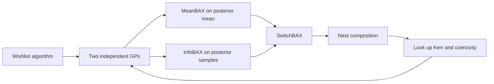

# Multi-property Bayesian algorithm execution

Reproduction notes by **Keshav**.

This directory reruns the Tutorial 4 Wishlist pipeline from the code released with [Targeted materials discovery using Bayesian algorithm execution](https://www.nature.com/articles/s41524-024-01326-2) ([arXiv](https://arxiv.org/abs/2312.16078)). The library, tutorials, and license are that project. The numbers below are the run executed on this machine on 12 October 2026.

## What was rerun

Tutorial 4 on the Fe–Co–Ni magnetic-alloy library: 921 compositions, Kerr rotation and coercivity. The goal is the notebook Wishlist, a union of three property bands:

| Kerr rotation (mrad) | Coercivity (mT) |
|---|---|
| 0.0 – 2.0 | 0.00 – 0.2 |
| 8.0 – 10.0 | 0.0 – 0.1 |
| 5.0 – 8.0 | 0.3 – 0.5 |

That algorithm marks **75** ground-truth target compositions. Each strategy starts from **1** random composition, then acquires **250** more points. Hyperparameters of the Gaussian process are fit once on the full dataset and then held fixed (`fixed_hypers = True` in the notebook). InfoBAX and SwitchBAX use **15** posterior samples. Two repeats use seeds 0 and 1. Strategies: SwitchBAX, MeanBAX, US, InfoBAX.

This is the notebook experiment, not a digit-level copy of Figure 5 in the paper. The paper’s magnetic-materials benchmark uses a different Wishlist (four bands), **10** initial points, **20** repeats, adaptive hyperparameter fits every 10 iterations, and **500** acquired points. The paper reports those curves in the figure rather than a table of final scores, so this README does not invent matching scalars.

## Results of this run

Final values after 250 acquisitions. Each pair is repeat 0, repeat 1.

| Strategy | Number Obtained | Posterior Jaccard |
|---|---|---|
| InfoBAX | 69, 70 | 0.765, 0.713 |
| SwitchBAX | 69, 69 | 0.744, 0.719 |
| MeanBAX | 68, 64 | 0.744, 0.708 |
| US | 25, 26 | 0.625, 0.641 |

Means of the two repeats at selected budgets:

| Iteration | InfoBAX n / Jaccard | SwitchBAX n / Jaccard | MeanBAX n / Jaccard | US n / Jaccard |
|---|---|---|---|---|
| 50 | 10.0 / 0.575 | 18.5 / 0.326 | 18.5 / 0.434 | 8.0 / 0.442 |
| 100 | 25.0 / 0.666 | 55.0 / 0.649 | 54.0 / 0.639 | 12.5 / 0.558 |
| 150 | 42.0 / 0.698 | 65.0 / 0.719 | 62.5 / 0.712 | 18.0 / 0.585 |
| 200 | 56.5 / 0.716 | 67.5 / 0.744 | 64.5 / 0.717 | 21.5 / 0.607 |
| 250 | 69.5 / 0.739 | 69.0 / 0.732 | 66.0 / 0.726 | 25.5 / 0.633 |

Number Obtained counts how many of the measured points lie in the true target set (maximum 75). Posterior Jaccard is the overlap between that true set and the set predicted from the posterior mean. It is a benchmark metric: a live experiment would not know the true set.


Full curves: [`outputs/tutorial4_wishlist_metrics.json`](outputs/tutorial4_wishlist_metrics.json).

### How this lines up with the paper

On this tutorial Wishlist, the same qualitative pattern described for the paper’s magnetic-alloy tasks shows up:

- SwitchBAX, MeanBAX, and InfoBAX all finish far above uncertainty sampling on Number Obtained (about 66–70 versus about 26, out of 75).
- MeanBAX and SwitchBAX pull ahead early. By iteration 100 they have obtained about 54–55 targets; InfoBAX has about 25.
- InfoBAX catches up by iteration 250 and has the highest mean Number Obtained (69.5) and the highest mean Posterior Jaccard (0.739).
- Uncertainty sampling raises Jaccard into the 0.6 range but collects targets slowly, which matches the paper’s point that reducing uncertainty everywhere is not the same as sampling the user-specified subset.

The early gap is large here because the run starts from a single point with hyperparameters frozen from the full dataset. The paper’s Figure 5 starts from 10 points and refits during the loop, over a different target set, for 500 steps. Those curves are not subtracted or rescaled into the table above.

## Architecture

The user writes a small algorithm that would return the desired subset if the true property map were known. Bayesian algorithm execution never needs that map. It keeps a surrogate, runs the same algorithm on the surrogate, and chooses the next composition to measure.



| Piece | Role |
|---|---|
| `src/algorithms.py` | Turns a goal into a subset of design-point ids. Wishlist is a union of property bands. |
| `src/models.py` | `MGPR`: one scikit-learn Gaussian process per measured property. |
| `src/acquisition.py` | InfoBAX, MeanBAX, SwitchBAX, and uncertainty sampling. |
| `src/metrics.py` | Number Obtained and Posterior Jaccard. |
| `src/plotting.py` | Ternary design-space plots and the metric curves. |
| `run_tutorial4.py` | Headless rerun of the Tutorial 4 loop. Saves JSON after every repeat. |

SwitchBAX executes the algorithm on the posterior mean and samples inside the predicted subset (MeanBAX). If that subset is already exhausted, it switches to InfoBAX for that iteration.

## Model and fit

Each property has its own Gaussian process. The kernel is the notebook kernel: a constant times a Matérn-5/2 kernel with one length scale per composition coordinate, plus a white-noise term. Inputs are scaled to `[0, 1]`. Outputs are scaled to `[-1, 1]`.

For this run, `fit_matern_hypers` fits those hyperparameters on all 921 compositions, then freezes them so every posterior sample shares the same kernel. There is no neural network and no GPU step. Scoring one InfoBAX iteration on this 921-point library took on the order of 1–2 seconds on CPU.

## Other tutorial numbers

Tutorials 1–3 only illustrate the goal and the two metrics. They are not the acquisition benchmark.

| Check | Result |
|---|---|
| Design space | 921 compositions, 2 properties |
| Level band, property 1 between 5 and 10 | 159 compositions |
| Percentile union at the 90th percentile of each property | 186 compositions |
| Number Obtained from 50 random draws against that percentile set | 6 |
| Posterior Jaccard after one GP fit on 23 training points | 0.414 |

## Run it again

From this directory, with the FeCoNi `.mat` file in `datasets/` (the notebook downloads `FeCoNi_benchmark_dataset_220501a.mat` from the NIST REMI repository):

```
python run_tutorial_demos.py
python run_tutorial4.py
```

`python run_tutorial4.py --only InfoBAX` reruns InfoBAX and merges it into the existing JSON. The acquisition loop is CPU-bound.

## Scope

Completed here: Tutorial 4 Wishlist, two repeats, 250 steps, fixed hyperparameters, four strategies. Not rerun: the paper’s 20-repeat, 500-step, adaptive-hyperparameter magnetic benchmark, the nanoparticle library, EHVI, or the multiband and Pareto goals. Software copyright remains the notice in `LICENSE`.
