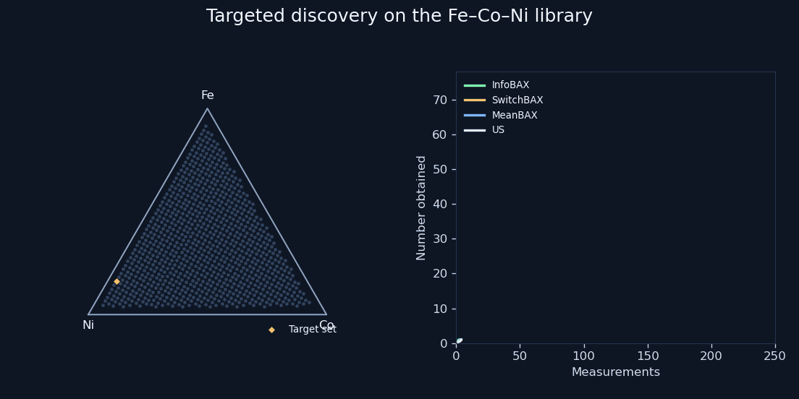
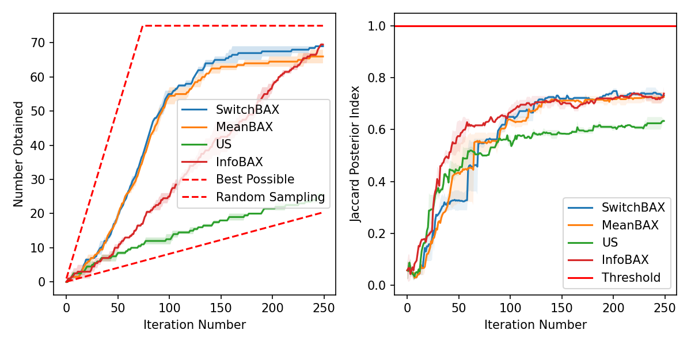
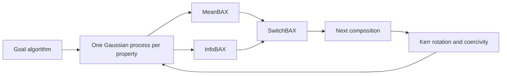

  

<h1 align="center">Targeted materials discovery with Bayesian algorithm execution</h1>

  Keshav
   
  Reproduction of
  <a href="https://www.nature.com/articles/s41524-024-01326-2"><em>Targeted materials discovery using Bayesian algorithm execution</em></a>
   
  npj Computational Materials (2024) · <a href="https://doi.org/10.1038/s41524-024-01326-2">doi:10.1038/s41524-024-01326-2</a>
  · <a href="https://arxiv.org/abs/2312.16078">arXiv</a>

The paper asks a practical question: given a design space of materials and a goal stated as a short algorithm, which composition should be measured next? The algorithm would return the right subset if every property were already known. Bayesian algorithm execution builds the search from that algorithm, using a Gaussian process as a stand-in for the unknown property map.

## Published result and this reproduction

The paper’s Fe–Co–Ni study is Figure 5. The library has 921 ternary compositions. Two measured properties are Kerr rotation and coercivity. Figure 5b is the Wishlist goal: a union of property bands, so the desired compositions are disjoint in the triangle. The paper draws the curves. It does not print a final score table. What Figure 5b shows:

- InfoBAX, MeanBAX, and SwitchBAX finish together, above uncertainty sampling, random search, and EHVI, on **Number Obtained**.
- The same three stay above uncertainty sampling on **Posterior Jaccard Index**.
- MeanBAX is stronger on a short budget. InfoBAX is stronger once the budget is long. SwitchBAX stays with the better of the two.

This reproduction measures the same two metrics on the Fe–Co–Ni Wishlist. Means of two repeats:

| | Paper, Figure 5b | Reproduced |
|---|---|---|
| InfoBAX | Finishes with the leading BAX group, best of the three on a long budget | **69.5** obtained · Jaccard **0.739** |
| SwitchBAX | Stays with the leading group across the budget | **69.0** obtained · Jaccard **0.732** |
| MeanBAX | Leads early, then levels off with the other BAX methods | **66.0** obtained · Jaccard **0.726** |
| Uncertainty sampling | Below the BAX group on both metrics | **25.5** obtained · Jaccard **0.633** |

Number Obtained is how many measured compositions sit in the true target set. Posterior Jaccard is the overlap between that true set and the set predicted from the posterior mean. In this reproduction the target set has 75 compositions, and the scores above are after 250 measurements.

The ordering matches Figure 5b. MeanBAX and SwitchBAX lead at 100 measurements (54 and 55 targets). InfoBAX is behind them there (25) and is first by 250 measurements.

| Measurements | InfoBAX | SwitchBAX | MeanBAX | Uncertainty sampling |
|---|---|---|---|---|
| 50 | 10.0 / 0.575 | 18.5 / 0.326 | 18.5 / 0.434 | 8.0 / 0.442 |
| 100 | 25.0 / 0.666 | 55.0 / 0.649 | 54.0 / 0.639 | 12.5 / 0.558 |
| 150 | 42.0 / 0.698 | 65.0 / 0.719 | 62.5 / 0.712 | 18.0 / 0.585 |
| 200 | 56.5 / 0.716 | 67.5 / 0.744 | 64.5 / 0.717 | 21.5 / 0.607 |
| 250 | 69.5 / 0.739 | 69.0 / 0.732 | 66.0 / 0.726 | 25.5 / 0.633 |

Each cell is mean Number Obtained / mean Posterior Jaccard.

## Architecture

A user writes the goal as a filter over properties. The same filter is run on the Gaussian process. The acquisition function then picks the next composition.

| Module | Role |
|---|---|
| `src/algorithms.py` | Goal as a subset of compositions. Wishlist is a union of property bands. |
| `src/models.py` | Independent Gaussian processes, one per property. |
| `src/acquisition.py` | InfoBAX, MeanBAX, SwitchBAX, uncertainty sampling. |
| `src/metrics.py` | Number Obtained and Posterior Jaccard. |
| `src/plotting.py` | Ternary diagram and metric curves. |

**MeanBAX** runs the goal on the posterior mean and samples inside the predicted subset, where the model is still uncertain.

**InfoBAX** runs the goal on posterior samples and picks the composition that most reduces uncertainty about the subset.

**SwitchBAX** uses MeanBAX, and switches to InfoBAX when the predicted subset is empty or already measured.

## Model

Each property is a separate Gaussian process: a constant kernel, a Matérn-5/2 kernel with one length scale per composition coordinate, and a white-noise term. Compositions are scaled to `[0, 1]`. Properties are scaled to `[-1, 1]`. Posterior samples used by InfoBAX and SwitchBAX share that kernel. The search is sequential and runs on CPU.

## Paper

[Targeted materials discovery using Bayesian algorithm execution](https://www.nature.com/articles/s41524-024-01326-2), npj Computational Materials **10**, 156 (2024). [doi:10.1038/s41524-024-01326-2](https://doi.org/10.1038/s41524-024-01326-2). [arXiv:2312.16078](https://arxiv.org/abs/2312.16078).

Software copyright is the notice in `LICENSE`.
